# Hi, I'm Abdul Julil Shahria 👋

## About me

- 🎓 Computer Science student
- 💻 I build full-stack web apps with the MERN stack (MongoDB, Express, React, Node.js)
- 📊 I work with data in Python using NumPy and pandas
- 🤖 I'm interested in AI and machine learning
- 🤝 Open to internships and collaboration on web or data projects

  
  

## Tech stack

   
  

  
  
  
  

## GitHub stats

  

## Activity overview

  

## Contributions

  

Stats refresh every day via GitHub Actions.

